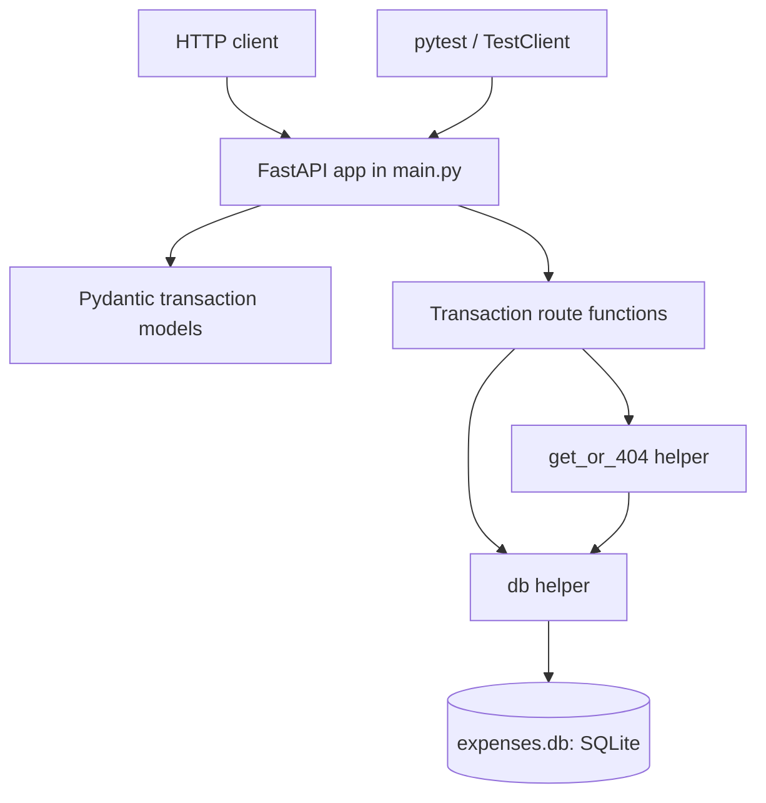
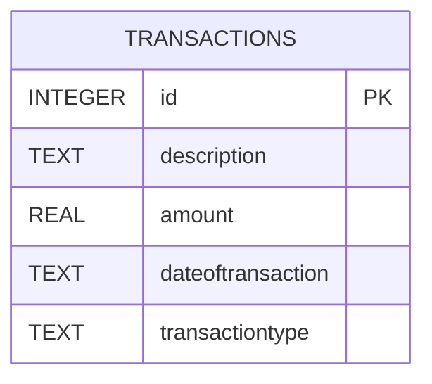
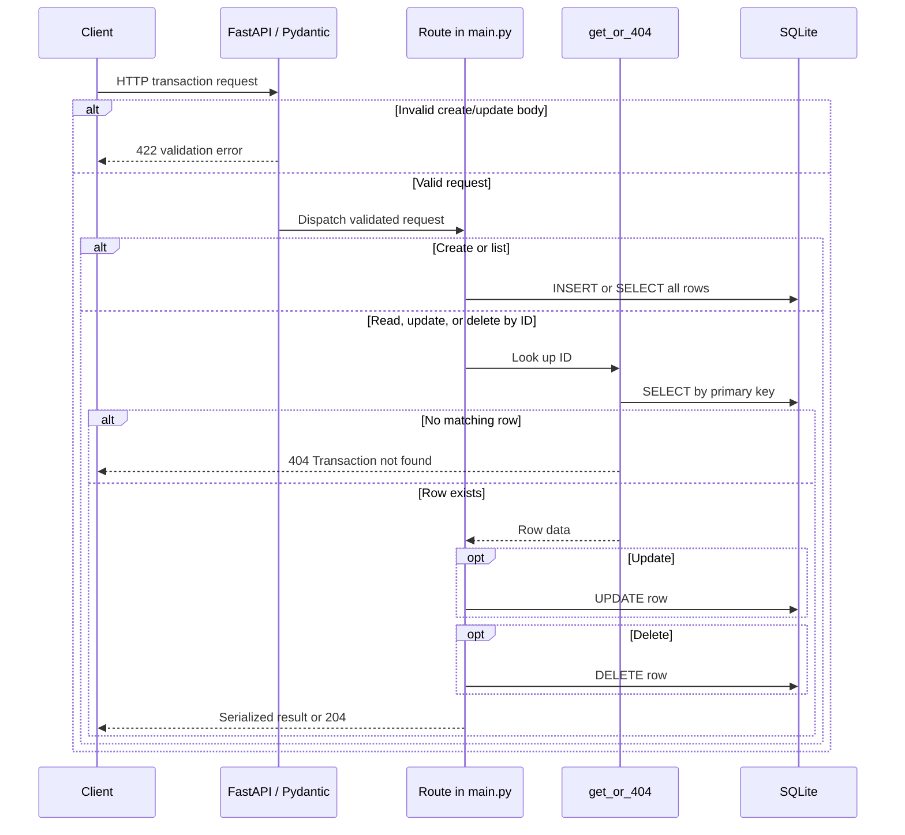

# Project Documentation

## 1. Overview

**Project name:** Expense Manager (FastAPI application title); the workspace directory is `expense-manager-backend`.

This project is a small HTTP API for creating, listing, reading, updating, and deleting income and expense transactions. The API is implemented in one Python module and persists records in a local SQLite database.

| Area | Technology |
| --- | --- |
| Language | Python; the minimum supported version is _Not determinable from source — please confirm._ The code uses built-in generic annotations such as `list[Transaction]`, which require Python 3.9 or newer. |
| Web framework | FastAPI |
| Data validation | Pydantic models (used through FastAPI) |
| Persistence | SQLite via Python's `sqlite3` standard library |
| ASGI server | Uvicorn |
| Tests | pytest and FastAPI `TestClient` (HTTPX is listed as a dependency) |

All application behavior currently lives in `main.py`; `tests/` contains transaction endpoint tests and their fixtures. Dependency versions are not pinned in `requirements.txt`.

## 2. Project Structure

```text
.
|-- .github/
|   `-- prompts/
|       `-- generate-docs.prompt.md
|-- tests/
|   |-- conftest.py
|   `-- test_transactions.py
|-- expenses.db
|-- main.py
|-- PROJECT_DOCUMENTATION.md
|-- pytest.ini
`-- requirements.txt
```

The checked-in workspace also contains a local virtual environment and Python/pytest cache files; these are omitted from the tree as environment or generated artifacts. `expenses.db` is the SQLite file named by the application, relative to the process working directory.

| Path | Responsibility |
| --- | --- |
| `main.py` | FastAPI application, Pydantic models, SQLite initialization/helpers, and transaction routes. |
| `tests/` | Endpoint tests and fixtures using an isolated temporary SQLite database. |
| `.github/prompts/` | A repository prompt for generating documentation; it is not imported by the application. |
| `requirements.txt` | Runtime and test package dependencies. |
| `pytest.ini` | pytest discovery path, import path, and verbosity configuration. |
| `expenses.db` | Local SQLite data file. Its contents are not used here as a schema source; the table definition is in `main.py`. |

**Observed organization:** application code is currently a single top-level module; tests use `test_*.py` naming and shared fixtures in `conftest.py`. There are no separate route, model, repository, migration, or configuration packages in the source tree.

## 3. Architecture

The application is a single-process, layered-at-the-function-level HTTP service: FastAPI route functions validate/serialize requests through Pydantic, then execute SQL directly against SQLite. There is no separate service or repository layer. On import, `main.py` opens the configured SQLite file and creates the table if it does not exist.



**Patterns actually present:**

| Pattern | Evidence |
| --- | --- |
| Request/response schema validation | `TransactionIn` and `Transaction` Pydantic models in `main.py`. |
| Shared not-found lookup | `get_or_404` centralizes row lookup and the 404 response in `main.py`. |
| Per-operation connection/context management | Route functions call `db()` and use SQLite connections as context managers in `main.py`. |
| Cross-origin middleware | `CORSMiddleware` is configured in `main.py` with wildcard origins, methods, and headers. |

No dependency-injection container, repository abstraction, authentication middleware, or migration framework is present in the inspected source.

## 4. Database Design

**Data store:** SQLite. The application uses the `DB` constant, set to the relative filename `expenses.db`; it may resolve to a different file if the process is started from a different working directory.

### `transactions`

| Column | SQLite type | API type | Key / constraints |
| --- | --- | --- | --- |
| `id` | `INTEGER` | `int` | `PRIMARY KEY AUTOINCREMENT` |
| `description` | `TEXT` | `str` | No SQL `NOT NULL` or other column constraint is declared. |
| `amount` | `REAL` | `float` | No SQL range or sign constraint is declared. |
| `dateoftransaction` | `TEXT` | `date` | API input is a date; writes store `date.isoformat()`. |
| `transactiontype` | `TEXT` | `Literal["income", "expense"]` | The accepted values are enforced by the API model; the SQLite column has no `CHECK` constraint. |



The table has no declared relationships or secondary indexes. The primary key is the only declared key/index strategy evident in the table definition. The source does not define currency, ownership, or a relationship to users/accounts.

## 5. Flow Diagrams

### Transaction requests

Each endpoint receives a request through FastAPI. Create and update requests are validated against `TransactionIn`; invalid model input is rejected by FastAPI with HTTP 422. Routes use `db()` for SQLite access. Operations requiring an existing ID call `get_or_404`; an absent row raises HTTP 404 with detail `Transaction not found`.



## 6. Components / Modules

Everything below is defined in `main.py` unless noted. Function signatures are shown as declared; functions without return annotations are marked accordingly.

| Component | Responsibility and location | Signature / fields | Dependencies and callers |
| --- | --- | --- | --- |
| `app` | FastAPI application titled `Expense Manager`; `main.py` | `FastAPI(title="Expense Manager")` | Configures CORS; route functions are registered on it. Tests access it through `TestClient`. |
| `TransactionIn` | Input schema; `main.py` | `description: str`, `amount: float`, `dateoftransaction: date`, `transactiontype: Literal["income", "expense"]` | Used as the request model for create and update. |
| `Transaction` | Response schema; `main.py` | Inherits `TransactionIn`; adds `id: int` | Used as the response model for create/read/update and list items. |
| `db` | Opens a SQLite connection and configures rows as `sqlite3.Row`; `main.py` | `db()`; return annotation not declared | Called by initialization and all route/helper database operations; reads `DB`. |
| `get_or_404` | Loads a transaction by ID or raises HTTP 404; `main.py` | `get_or_404(c, id: int)`; return annotation not declared | Called by create, read, update, and delete; receives a connection created by those callers. |
| `create` | Inserts a transaction; `main.py` | `create(t: TransactionIn)` | `POST /transactions`; uses `db`, `TransactionIn`, and `get_or_404`. |
| `list_all` | Returns all transaction rows; `main.py` | `list_all()` | `GET /transactions`; uses `db`. No explicit ordering is specified. |
| `read` | Returns one transaction; `main.py` | `read(id: int)` | `GET /transactions/{id}`; uses `db` and `get_or_404`. |
| `update` | Replaces the supplied transaction fields for an existing row; `main.py` | `update(id: int, t: TransactionIn)` | `PUT /transactions/{id}`; uses `db`, `TransactionIn`, and `get_or_404`. |
| `delete` | Deletes an existing transaction; `main.py` | `delete(id: int)` | `DELETE /transactions/{id}`; uses `db` and `get_or_404`. |
| Test fixtures and endpoint tests | `tests/conftest.py`, `tests/test_transactions.py` | `client` and `sample` fixtures; tests cover CRUD, invalid transaction type, and missing IDs | `TestClient` calls `main.app`; the fixture redirects `main.DB` to a temporary database and creates the table. |

## 7. API / Endpoint Reference

No authentication or authorization dependency is attached to the routes. The application configures CORS to allow all origins, methods, and headers. No other access-control behavior is defined in the source.

All create/update bodies use the required fields in `TransactionIn`; there are no declared defaults or additional numeric/string constraints. `transactiontype` accepts only `income` or `expense`. `dateoftransaction` is a date and is sent as a JSON date string. Successful transaction responses contain `id` plus all four input fields.

| Method and path | Purpose | Request | Success response | Other behavior evidenced in source/tests |
| --- | --- | --- | --- | --- |
| `POST /transactions` | Create a transaction | JSON `TransactionIn` body | `201`; `Transaction` JSON | Invalid type is tested to return `422`. |
| `GET /transactions` | List transactions | None | `200`; array of `Transaction` | Empty list is tested; SQL has no `ORDER BY`. |
| `GET /transactions/{id}` | Read one transaction | Path `id: int` | `200`; `Transaction` JSON | Missing row returns `404`, detail `Transaction not found` (tested). |
| `PUT /transactions/{id}` | Replace all transaction input fields | Path `id: int`; JSON `TransactionIn` body | `200`; `Transaction` JSON | Missing row returns `404` (tested). |
| `DELETE /transactions/{id}` | Delete one transaction | Path `id: int` | `204`; no response body | Missing row returns `404` (tested). |

**Example from tests** (`tests/conftest.py` and `tests/test_transactions.py`):

```http
POST /transactions
Content-Type: application/json

{
  "description": "Lunch",
  "amount": 12.5,
  "dateoftransaction": "2026-11-02",
  "transactiontype": "expense"
}
```

The test asserts this response when creating the first row in its fresh test database:

```json
{
  "id": 1,
  "description": "Lunch",
  "amount": 12.5,
  "dateoftransaction": "2026-11-02",
  "transactiontype": "expense"
}
```

## 8. Configuration & Environment

| Name | Kind | Purpose |
| --- | --- | --- |
| `DB` | Python constant in `main.py` | SQLite filename; defaults to `expenses.db` relative to the process working directory. |

No environment variables, settings file, secrets, or deployment configuration are defined in the inspected project files. CORS policy is configured inline in `main.py` as wildcard origins, methods, and headers. Package versions are unpinned.

No build, run, or deploy scripts, Makefile, or CI configuration were found. The following local commands are inferred from the declared dependencies and exported `main:app`, rather than being defined as project scripts:

```powershell
python -m pip install -r requirements.txt
python -m uvicorn main:app --reload
```

## 9. Setup & Local Development

**Prerequisites:** a Python interpreter compatible with the source (the code's built-in `list[...]` annotation requires Python 3.9 or newer) and `pip`. A precise supported-version range is _Not determinable from source — please confirm._

Install dependencies from the repository root:

```powershell
python -m pip install -r requirements.txt
```

Start the development server from the repository root:

```powershell
python -m uvicorn main:app --reload
```

The application initializes the `transactions` table on import. The default database file is `expenses.db` in the current working directory. The repository does not include a separate setup or migration command.

Run the test suite from the repository root:

```powershell
python -m pytest
```

`pytest.ini` sets `testpaths = tests`, adds the current directory to `pythonpath`, and enables verbose output. Tests use a temporary SQLite file rather than the default database.

## 10. Glossary & Open Questions

| Term | Meaning evidenced in source |
| --- | --- |
| Transaction | A record with a description, amount, date, and type. |
| Income | One of the two allowed transaction types. |
| Expense | One of the two allowed transaction types. |
| `TransactionIn` | Pydantic model for transaction create/update input. |
| `Transaction` | `TransactionIn` plus the database-generated integer ID. |

**Open questions / gaps:**

- The supported Python and dependency version ranges are _Not determinable from source — please confirm._
- The currency and interpretation/rounding rules for `amount` are _Not determinable from source — please confirm._
- Whether transactions should be associated with users, accounts, or budgets is _Not determinable from source — please confirm._
- Authentication and authorization requirements are _Not determinable from source — please confirm_; no auth mechanism is implemented in the inspected application.
- The intended production database, deployment platform, backup policy, and data-retention policy are _Not determinable from source — please confirm._
- Whether broad wildcard CORS access is intentional outside local development is _Not determinable from source — please confirm._
- There is no explicit ordering guarantee for the transaction list; the intended ordering is _Not determinable from source — please confirm._