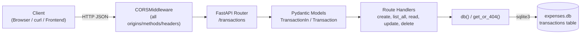
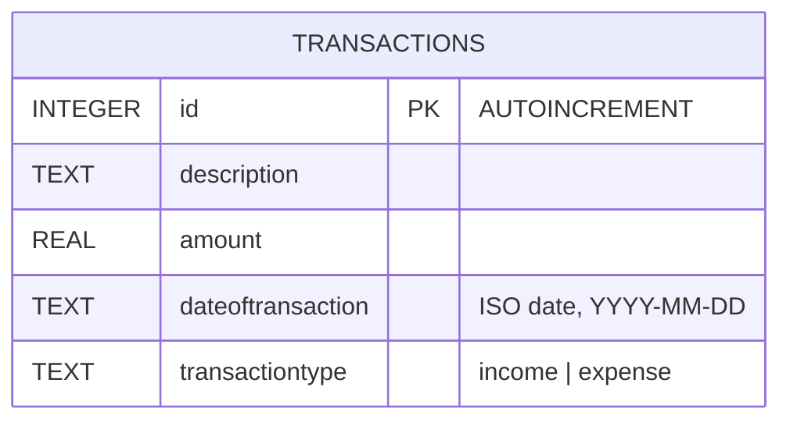
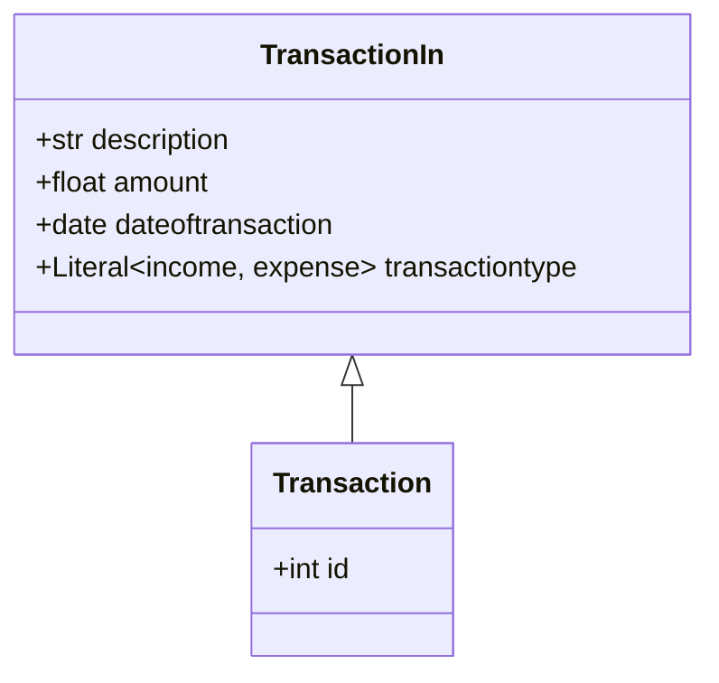
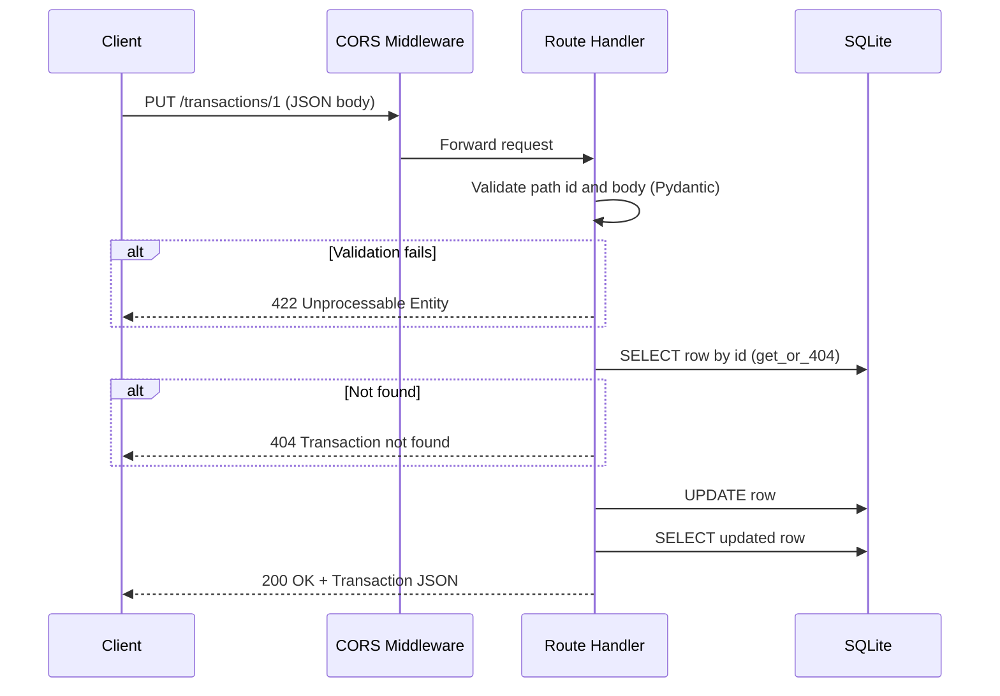

# Expense Manager Backend

A minimal REST API built with **FastAPI** and **SQLite** for recording income and expense transactions. It supports full CRUD (Create, Read, Update, Delete) and allows cross-origin requests from any origin.

## Table of Contents

- [Features](#features)
- [Tech Stack](#tech-stack)
- [Project Structure](#project-structure)
- [Architecture](#architecture)
- [Database Diagram](#database-diagram)
- [Model Structure](#model-structure)
- [Execution Flow](#execution-flow)
- [Endpoint Details](#endpoint-details)
- [Error Handling](#error-handling)
- [CORS](#cors)
- [Getting Started](#getting-started)
- [Example Usage](#example-usage)

## Features

- CRUD operations on transactions
- Request/response validation with Pydantic
- Persistent storage in a local SQLite file (`expenses.db`), created automatically
- CORS enabled for all origins, methods and headers
- Auto-generated interactive docs (Swagger UI and ReDoc)

## Tech Stack

| Component  | Technology                |
|------------|---------------------------|
| Framework  | FastAPI                   |
| Server     | Uvicorn (ASGI)            |
| Validation | Pydantic                  |
| Database   | SQLite (stdlib `sqlite3`) |

## Project Structure

```
expense-manager-backend/
├── main.py            # App, models, DB helpers and all endpoints
├── requirements.txt   # Python dependencies
├── README.md          # This file
└── expenses.db        # SQLite database (created on first run)
```

## Architecture

The app is a single-module, layered service: the HTTP layer validates input, route handlers run SQL through a small DB helper, and data is persisted in SQLite.



| Layer        | Responsibility                                              |
|--------------|-------------------------------------------------------------|
| Middleware   | Adds CORS headers and handles preflight requests            |
| Models       | Validate request bodies and serialize responses             |
| Handlers     | Implement CRUD logic with parameterized SQL                 |
| DB helper    | `db()` opens a connection with `sqlite3.Row` row factory; `get_or_404()` fetches a row or raises `404` |

## Database Diagram

A single table, `transactions`, is created on startup if it does not exist.



DDL:

```sql
CREATE TABLE IF NOT EXISTS transactions (
    id INTEGER PRIMARY KEY AUTOINCREMENT,
    description TEXT,
    amount REAL,
    dateoftransaction TEXT,
    transactiontype TEXT
);
```

## Model Structure



| Field               | Type                       | Required | Notes                                  |
|---------------------|----------------------------|----------|----------------------------------------|
| `id`                | integer                    | response only | Auto-generated primary key        |
| `description`       | string                     | yes      | Free text                              |
| `amount`            | float                      | yes      | Transaction amount                     |
| `dateoftransaction` | date (`YYYY-MM-DD`)        | yes      | Stored as ISO text                     |
| `transactiontype`   | `"income"` \| `"expense"`  | yes      | Any other value returns `422`          |

- `TransactionIn` is used for request bodies (create/update).
- `Transaction` extends it with `id` and is used for responses.

## Execution Flow

### Application startup

1. `main.py` is loaded by Uvicorn.
2. The `FastAPI` app is created and `CORSMiddleware` is added.
3. The `transactions` table is created if it does not exist.
4. The server starts accepting requests.

### Request lifecycle (example: `PUT /transactions/{id}`)



Other operations follow the same pattern: `POST` inserts then returns the new row; `DELETE` checks existence, deletes, and returns an empty `204`.

## Endpoint Details

Base URL: `http://127.0.0.1:8000`

| Method | Path                    | Description                 | Request Body    | Success Response                  |
|--------|-------------------------|-----------------------------|-----------------|-----------------------------------|
| POST   | `/transactions`         | Create a transaction        | `TransactionIn` | `201 Created` + `Transaction`     |
| GET    | `/transactions`         | List all transactions       | none            | `200 OK` + `Transaction[]`        |
| GET    | `/transactions/{id}`    | Get a transaction by id     | none            | `200 OK` + `Transaction`          |
| PUT    | `/transactions/{id}`    | Replace a transaction       | `TransactionIn` | `200 OK` + `Transaction`          |
| DELETE | `/transactions/{id}`    | Delete a transaction        | none            | `204 No Content`                  |

### Request body (POST / PUT)

```json
{
  "description": "Groceries",
  "amount": 54.75,
  "dateoftransaction": "2026-11-02",
  "transactiontype": "expense"
}
```

### Response body

```json
{
  "id": 1,
  "description": "Groceries",
  "amount": 54.75,
  "dateoftransaction": "2026-11-02",
  "transactiontype": "expense"
}
```

## Error Handling

| Status | When                                                              |
|--------|-------------------------------------------------------------------|
| `404`  | `{id}` does not exist (`{"detail": "Transaction not found"}`)     |
| `422`  | Invalid body or path parameter (missing field, bad date, invalid `transactiontype`, non-integer id) |

## CORS

`CORSMiddleware` is configured with `allow_origins=["*"]`, `allow_methods=["*"]` and `allow_headers=["*"]`, so any browser frontend can call the API. Restrict these for production use.

## Getting Started

### Prerequisites

- Python 3.9+

### Install and run

```bash
pip install -r requirements.txt
uvicorn main:app --reload
```

The API is served at `http://127.0.0.1:8000`.

| URL                              | Purpose        |
|----------------------------------|----------------|
| `http://127.0.0.1:8000/docs`     | Swagger UI     |
| `http://127.0.0.1:8000/redoc`    | ReDoc          |
| `http://127.0.0.1:8000/openapi.json` | OpenAPI schema |

## Example Usage

```bash
# Create
curl -X POST http://127.0.0.1:8000/transactions \
  -H "Content-Type: application/json" \
  -d '{"description":"Salary","amount":5000,"dateoftransaction":"2026-11-01","transactiontype":"income"}'

# List
curl http://127.0.0.1:8000/transactions

# Get one
curl http://127.0.0.1:8000/transactions/1

# Update
curl -X PUT http://127.0.0.1:8000/transactions/1 \
  -H "Content-Type: application/json" \
  -d '{"description":"Salary","amount":5200,"dateoftransaction":"2026-11-01","transactiontype":"income"}'

# Delete
curl -X DELETE http://127.0.0.1:8000/transactions/1
```
